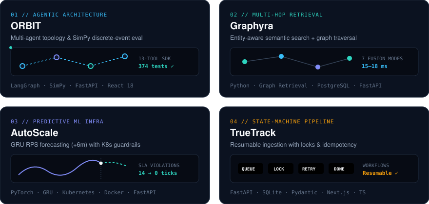

  

  <a href="mailto:vickylm258@gmail.com"><code>email</code></a> ·
  <a href="https://github.com/Vicky-258"><code>github</code></a> ·
  <a href="https://www.linkedin.com/in/vignesh258/"><code>linkedin</code></a> ·
  <a href="https://leetcode.com/u/Vicky258/"><code>leetcode</code></a>

---

### 01. Engineering Focus

I build **reliable AI/ML systems and backend infrastructure** — from multi-agent decision platforms and low-latency graph retrieval engines to predictive Kubernetes autoscalers and resumable state-machine pipelines.

---

### 02. Systems I've Built

  

<b>Architectural Breakdown &amp; Benchmarks</b>

- **ORBIT** — Built a multi-agent decision platform (`LangGraph`, `LangChain`, `SimPy`, `FastAPI`, `React 18`) that generates Pareto-optimal cloud topologies from natural-language specs using a 13-tool Simulation SDK, bounded clarification dialogue, provenance tags (`MEASURED`, `EMPIRICAL`, `SIMULATED`), and a **374-test verification suite**.
- **Graphyra** — Engineered an entity-aware multi-hop retrieval engine (`Python`, `PostgreSQL`, `FastAPI`) combining semantic search with priority-driven graph traversal. Benchmarked **15–18 ms** search latency across **59+ test cases** and **7 candidate-fusion strategies** (Precision@K, Recall@K, MRR).
- **AutoScale** — Built a simulation-based Kubernetes autoscaler (`PyTorch`, `GRU`, `Kubernetes`, `Docker`) forecasting RPS **6 minutes ahead** from 15 minutes of telemetry with 97.5th-percentile residual bounds and `+3/-2` replica limits, cutting SLA-violation ticks from **14 → 0** vs. reactive HPA.
- **TrueTrack** — Designed a local-first music ingestion pipeline (`FastAPI`, `SQLite`, `Pydantic`, `Next.js`, `TypeScript`) with persisted state-machine workflows, idempotency keys, worker locks, and retry/backoff recovery.

---

### 03. Core Stack

| Layer | Technologies |
| :--- | :--- |
| **Languages** | `Python` · `Rust` · `C` · `SQL` · `TypeScript` |
| **AI / ML & Retrieval** | `PyTorch` · `scikit-learn` · `LangGraph` · `LangChain` · `FAISS` · `Sentence Transformers` · `Ollama` |
| **Backend & UI** | `FastAPI` · `Pydantic` · `Async Workers` · `Next.js` · `React` · `Tailwind CSS` |
| **Data & Infra** | `PostgreSQL` · `SQLite` · `SimPy` · `Docker` · `Kubernetes` · `Linux` · `pytest` |

---

### 04. Milestones & Activity

- **Smart India Hackathon (SIH) 2025** — Advanced from institute-level selection to the **national-level evaluation stage**.
- **CodeX Trade 2024** — **Finalist** at PSG Institute of Technology and Applied Research (PSG iTech).
- **LeetCode** — **250+** algorithmic problems solved.

  <picture>
    <source media="(prefers-color-scheme: dark)" srcset="https://raw.githubusercontent.com/Vicky-258/Vicky-258/output/github-contribution-grid-snake-dark.svg" />
    <source media="(prefers-color-scheme: light)" srcset="https://raw.githubusercontent.com/Vicky-258/Vicky-258/output/github-contribution-grid-snake.svg" />
    
  </picture>

 

  

