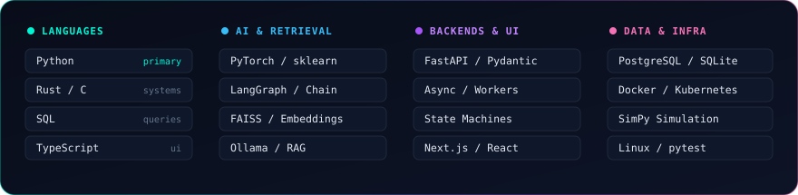

  

  <a href="mailto:vickylm258@gmail.com"><code>vickylm258@gmail.com</code></a> ·
  <a href="https://github.com/Vicky-258"><code>github</code></a> ·
  <a href="https://www.linkedin.com/in/YOUR_LINKEDIN_HANDLE"><code>linkedin</code></a> ·
  <a href="https://leetcode.com/u/YOUR_LEETCODE_HANDLE"><code>leetcode</code></a>

---

### 01 // About Me

I'm **Vigneshkumar S**, an **AI/ML & Systems Engineer** pursuing a **B.Tech in Artificial Intelligence and Machine Learning** (2023–2027) at *Sri Shakthi Institute of Engineering and Technology*.

I build **deterministic, observable, and fault-tolerant systems** — bridging applied AI with resilient backend engineering and cloud infrastructure.

---

### 02 // What I Work On

  

 

- **`01 · Applied AI`** — Multi-agent workflows (`LangGraph`, `LangChain`), discrete-event simulation (`SimPy`), local LLMs (`Ollama`), bounded clarification loops, and automated evaluation guardrails.
- **`02 · Retrieval & RAG`** — Entity-aware multi-hop graph traversal, dense semantic search (`FAISS`, `Sentence Transformers`), hybrid candidate-fusion strategies, and low-latency evidence ranking (`PostgreSQL`).
- **`03 · Backends`** — Async job-control APIs (`FastAPI`, `Pydantic`), persistent state-machine workflows, idempotency keys, worker locks, retry/backoff recovery, and systems code in `Rust` & `C`.
- **`04 · ML Infra`** — Time-series forecasting (`PyTorch` GRU) for proactive `Kubernetes` autoscaling, deterministic cooldown/burst safeguards, containerized workloads (`Docker`), and verification (`pytest`).

---

### 03 // Tech Matrix

  

 

  

